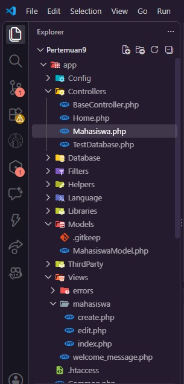
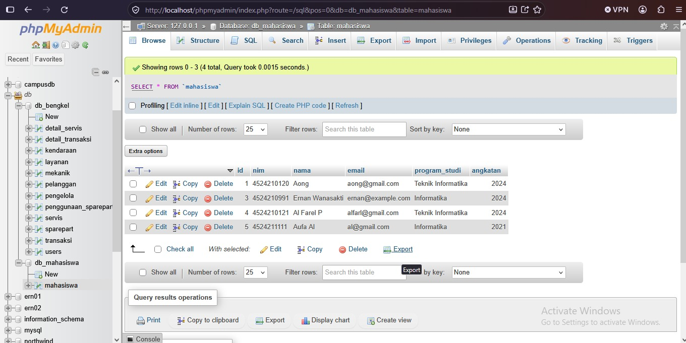
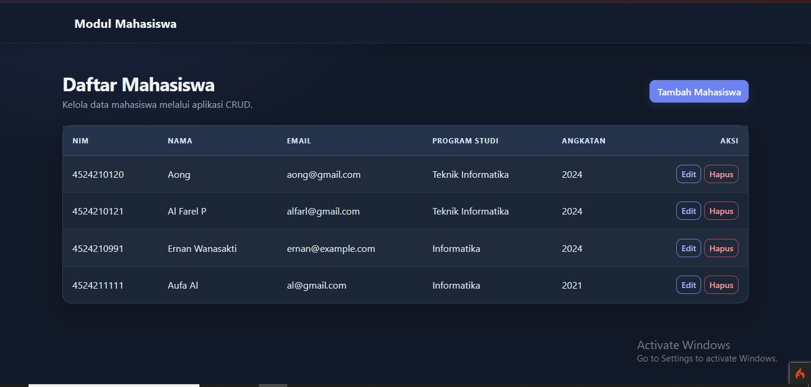
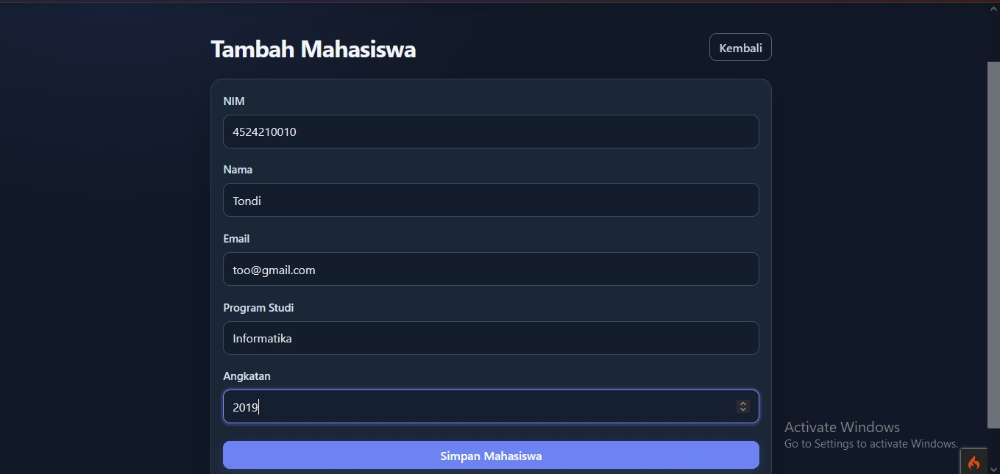
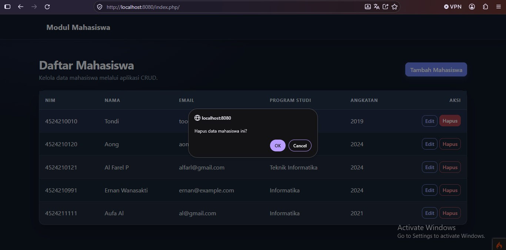
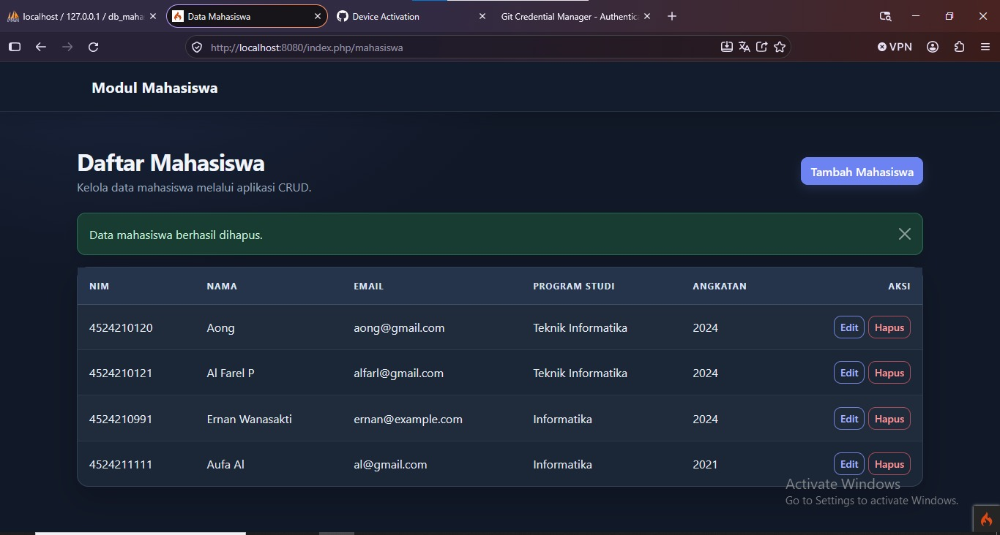

# LAPORAN PRAKTIKUM PEMROGRAMAN BERBASIS WEB

# IMPLEMENTASI SISTEM CRUD DATA MAHASISWA MENGGUNAKAN CODEIGNITER 4

<div align="center">

**UNIVERSITAS PANCASILA**

**PROGRAM STUDI INFORMATIKA**

**TAHUN AKADEMIK 2026/2027**

</div>

---

## IDENTITAS KELOMPOK

| No. | Nama Anggota               |    NPM     |
| :-: | -------------------------- | :--------: |
|  1  | Ernan Wanasakti            | 4524210121 |
|  2  | Andrian Marningot Pasaribu | 4524210120 |
|  3  | Muhammad Al Farel P H      | 4524210113 |
|  4  | Aufa Al Ghiyats S P        | 4524210132 |

**Mata Kuliah:** Pemrograman Berbasis Web  
**Dosen Pengampu:** [Nama Dosen]  
**Kelas:** [Kelas Praktikum]  
**Topik Praktikum:** Implementasi CRUD Menggunakan CodeIgniter 4

---

# 1. DESKRIPSI APLIKASI

Aplikasi CRUD Data Mahasiswa merupakan aplikasi berbasis web yang digunakan untuk mengelola informasi mahasiswa. Aplikasi ini dikembangkan menggunakan framework CodeIgniter 4 dengan database MySQL.

Aplikasi menyediakan fitur utama berupa Create, Read, Update, dan Delete (CRUD), yaitu menambahkan, menampilkan, mengubah, serta menghapus data mahasiswa.

Data mahasiswa yang dikelola meliputi:

- NIM
- Nama
- Email
- Program Studi
- Angkatan

Aplikasi menerapkan konsep Model-View-Controller (MVC) untuk memisahkan proses pengelolaan data, alur aplikasi, dan tampilan antarmuka.

Selain itu, aplikasi dilengkapi dengan validasi input dan notifikasi untuk memberikan informasi kepada pengguna ketika melakukan proses pengelolaan data.

# 2. TEKNOLOGI DAN PERANGKAT PENGEMBANGAN

Teknologi dan perangkat yang digunakan dalam pengembangan aplikasi adalah:

| No. | Teknologi          | Fungsi                                  |
| :-: | ------------------ | --------------------------------------- |
|  1  | PHP                | Bahasa pemrograman backend              |
|  2  | CodeIgniter 4      | Framework aplikasi web                  |
|  3  | MySQL              | Database penyimpanan data               |
|  4  | Bootstrap 5        | Komponen antarmuka                      |
|  5  | HTML               | Struktur halaman web                    |
|  6  | CSS                | Pengaturan tampilan aplikasi            |
|  7  | JavaScript         | Interaksi pada antarmuka jika digunakan |
|  8  | XAMPP              | Lingkungan server lokal                 |
|  9  | Visual Studio Code | Editor kode program                     |
| 10  | Git dan GitHub     | Pengelolaan versi dan repository        |

# 3. STRUKTUR PROJECT

## 3.1 Struktur Folder

Project dikembangkan menggunakan struktur direktori CodeIgniter 4. Berikut merupakan gambaran struktur folder utama aplikasi:

```text
Pertemuan9/
│
├── app/
│   ├── Config/
│   │   └── Routes.php
│   │
│   ├── Controllers/
│   │   └── Mahasiswa.php
│   │
│   ├── Models/
│   │   └── MahasiswaModel.php
│   │
│   └── Views/
│       └── mahasiswa/
│           ├── index.php
│           ├── create.php
│           └── edit.php
│
├── database/
├── public/
├── screenshots/
├── tests/
├── writable/
├── .env
├── composer.json
├── composer.lock
├── README.md
└── spark
```

_Catatan: Struktur di atas merupakan gambaran file utama. Sesuaikan dengan struktur aktual project yang digunakan._

## 3.2 Dokumentasi Struktur Project

Berikut merupakan tampilan struktur folder project pada Visual Studio Code.



## 3.3 Penjelasan File Utama

| File                 | Fungsi                                             |
| -------------------- | -------------------------------------------------- |
| `MahasiswaModel.php` | Mengelola interaksi data mahasiswa dengan database |
| `Mahasiswa.php`      | Mengatur proses CRUD dan validasi                  |
| `index.php`          | Menampilkan daftar mahasiswa                       |
| `create.php`         | Menampilkan formulir tambah mahasiswa              |
| `edit.php`           | Menampilkan formulir edit mahasiswa                |
| `Routes.php`         | Mengatur alamat dan pemetaan request               |
| `.env`               | Menyimpan konfigurasi aplikasi dan database        |

# 4. IMPLEMENTASI DATABASE

## 4.1 Nama Database

Database yang digunakan dalam aplikasi ini adalah:

```sql
db_mahasiswa
```

## 4.2 Nama Tabel

Tabel utama yang digunakan untuk menyimpan informasi mahasiswa adalah:

```sql
mahasiswa
```

## 4.3 Struktur Tabel Mahasiswa

| No. | Nama Kolom    | Tipe Data         | Keterangan                  |
| :-: | ------------- | ----------------- | --------------------------- |
|  1  | id            | INT UNSIGNED      | Primary Key, Auto Increment |
|  2  | nim           | VARCHAR(20)       | Unique, tidak boleh kosong  |
|  3  | nama          | VARCHAR(100)      | Tidak boleh kosong          |
|  4  | email         | VARCHAR(100)      | Unique, tidak boleh kosong  |
|  5  | program_studi | VARCHAR(100)      | Tidak boleh kosong          |
|  6  | angkatan      | SMALLINT UNSIGNED | Tidak boleh kosong          |

## 4.4 Aturan Data

Ketentuan data yang diterapkan pada tabel mahasiswa:

1. Kolom `id` digunakan sebagai primary key.
2. Kolom `nim` memiliki aturan unique agar tidak terdapat NIM yang sama.
3. Kolom `email` memiliki aturan unique agar tidak terdapat email yang sama.
4. Seluruh kolom informasi mahasiswa wajib diisi.

## 4.5 Dokumentasi Database

Database dikelola menggunakan phpMyAdmin melalui MySQL pada XAMPP.

Berikut merupakan tampilan tabel mahasiswa yang digunakan dalam aplikasi.



# 5. IMPLEMENTASI APLIKASI

## 5.1 Halaman Daftar Mahasiswa (Read)

Halaman daftar mahasiswa merupakan halaman utama aplikasi. Halaman ini menampilkan seluruh data mahasiswa yang telah tersimpan pada database.

Informasi yang ditampilkan meliputi NIM, nama, email, program studi, dan angkatan.

Pada halaman ini juga tersedia tombol untuk menambahkan data mahasiswa serta tindakan untuk mengedit dan menghapus data.



## 5.2 Tambah Mahasiswa (Create)

Fitur tambah mahasiswa digunakan untuk memasukkan data mahasiswa baru ke dalam database.

Pengguna mengisi formulir yang terdiri dari NIM, nama, email, program studi, dan angkatan. Setelah formulir dikirim, Controller memproses data dan Model melakukan penyimpanan ke database.

Apabila data berhasil disimpan, pengguna akan diarahkan kembali ke halaman daftar mahasiswa.



## 5.3 Edit Mahasiswa (Update)

Fitur edit mahasiswa digunakan untuk memperbarui informasi mahasiswa yang telah tersimpan.

Ketika pengguna memilih tombol Edit, aplikasi menampilkan formulir yang telah terisi dengan data mahasiswa sebelumnya. Pengguna dapat mengubah informasi yang diperlukan, kemudian menyimpan perubahan tersebut.

Setelah proses pembaruan berhasil, data terbaru akan ditampilkan pada halaman daftar mahasiswa.


## 5.4 Konfirmasi Hapus Mahasiswa (Delete)

Fitur hapus mahasiswa digunakan untuk menghapus data mahasiswa dari database.

Ketika pengguna memilih tombol Hapus pada salah satu data mahasiswa, aplikasi menampilkan notifikasi konfirmasi penghapusan.

Konfirmasi tersebut bertujuan untuk memastikan bahwa pengguna benar-benar ingin menghapus data yang dipilih.



## 5.5 Notifikasi Berhasil Menghapus Data

Setelah pengguna mengonfirmasi penghapusan, aplikasi menjalankan proses penghapusan data dari database.

Jika proses berhasil, aplikasi kembali menampilkan halaman daftar mahasiswa. Data yang sebelumnya dipilih sudah tidak muncul pada daftar, dan aplikasi menampilkan notifikasi bahwa data mahasiswa berhasil dihapus.



# 6. IMPLEMENTASI MODEL-VIEW-CONTROLLER (MVC)

Aplikasi menggunakan konsep Model-View-Controller (MVC) yang merupakan pola arsitektur untuk memisahkan tanggung jawab setiap bagian aplikasi.

## 6.1 Model

Model bertanggung jawab mengelola data dan berkomunikasi dengan database.

Pada aplikasi ini, file `MahasiswaModel.php` digunakan untuk mengelola data mahasiswa.

Contoh konfigurasi Model CodeIgniter 4:

```php
<?php

namespace App\Models;

use CodeIgniter\Model;

class MahasiswaModel extends Model
{
    protected $table = 'mahasiswa';
    protected $primaryKey = 'id';

    protected $allowedFields = [
        'nim',
        'nama',
        'email',
        'program_studi',
        'angkatan'
    ];
}
```

## 6.2 Controller

Controller bertugas mengatur alur aplikasi, menerima request dari pengguna, memanggil Model, dan menentukan halaman yang ditampilkan.

Pada aplikasi ini, file `Mahasiswa.php` digunakan untuk mengatur proses CRUD mahasiswa.

Contoh pemanggilan Model untuk menampilkan data:

```php
public function index()
{
    $data['mahasiswa'] = $this->mahasiswaModel->findAll();

    return view('mahasiswa/index', $data);
}
```

## 6.3 View

View bertanggung jawab menampilkan antarmuka aplikasi kepada pengguna.

Pada aplikasi ini terdapat tiga halaman utama:

| File View    | Fungsi                                |
| ------------ | ------------------------------------- |
| `index.php`  | Menampilkan daftar mahasiswa          |
| `create.php` | Menampilkan formulir tambah mahasiswa |
| `edit.php`   | Menampilkan formulir edit mahasiswa   |

## 6.4 Alur Kerja MVC

Alur kerja MVC pada aplikasi adalah sebagai berikut:

1. Pengguna mengakses halaman melalui browser.
2. Request diterima oleh sistem routing CodeIgniter 4.
3. Controller memproses permintaan pengguna.
4. Controller memanggil Model apabila membutuhkan akses database.
5. Model berinteraksi dengan database MySQL.
6. Data hasil proses diteruskan kembali ke Controller.
7. Controller menampilkan View kepada pengguna.

# 7. IMPLEMENTASI CRUD

## 7.1 Create

Create merupakan proses penambahan data baru ke dalam database.

Pada aplikasi ini, proses Create dilakukan melalui formulir tambah mahasiswa. Data yang telah dimasukkan pengguna akan diproses oleh Controller dan disimpan menggunakan Model.

Contoh operasi penyimpanan data:

```php
$this->mahasiswaModel->insert($data);
```

## 7.2 Read

Read merupakan proses mengambil dan menampilkan data dari database.

Pada aplikasi ini, data mahasiswa ditampilkan dalam bentuk tabel pada halaman utama.

Contoh operasi pengambilan seluruh data:

```php
$data['mahasiswa'] = $this->mahasiswaModel->findAll();
```

## 7.3 Update

Update merupakan proses memperbarui data yang sudah tersimpan.

Pengguna dapat memilih data mahasiswa yang ingin diperbarui melalui tombol Edit.

Contoh operasi pembaruan data:

```php
$this->mahasiswaModel->update($id, $data);
```

## 7.4 Delete

Delete merupakan proses menghapus data dari database.

Penghapusan dilakukan setelah pengguna memilih tombol Hapus dan mengonfirmasi tindakan tersebut.

Contoh operasi penghapusan data:

```php
$this->mahasiswaModel->delete($id);
```

_Catatan: Potongan kode pada bagian implementasi merupakan contoh representatif penggunaan Model CodeIgniter 4. Sesuaikan dengan nama variabel dan implementasi aktual pada file project._

# 8. VALIDASI DAN NOTIFIKASI

## 8.1 Validasi Data

Validasi digunakan untuk memeriksa data yang dimasukkan pengguna sebelum diproses oleh aplikasi.

Ketentuan validasi data mahasiswa meliputi:

| Kolom         | Ketentuan                                              |
| ------------- | ------------------------------------------------------ |
| NIM           | Wajib diisi, maksimal 20 karakter, dan harus unik      |
| Nama          | Wajib diisi, minimal 3 karakter, maksimal 100 karakter |
| Email         | Wajib diisi, format email valid, dan harus unik        |
| Program Studi | Wajib diisi, maksimal 100 karakter                     |
| Angkatan      | Wajib diisi dan berupa angka dengan 4 digit            |

Apabila data tidak sesuai dengan ketentuan, aplikasi akan menampilkan pesan kesalahan pada formulir.

## 8.2 Notifikasi Aplikasi

Notifikasi digunakan untuk memberikan informasi kepada pengguna setelah melakukan suatu tindakan.

Pada aplikasi ini, notifikasi ditampilkan ketika pengguna melakukan proses penghapusan data. Sebelum data dihapus, aplikasi menampilkan konfirmasi. Setelah penghapusan berhasil, aplikasi menampilkan notifikasi keberhasilan.

# 9. PENGUJIAN FUNGSIONALITAS

## 9.1 Tujuan Pengujian

Pengujian dilakukan untuk memastikan setiap fitur aplikasi berjalan sesuai dengan fungsi yang telah dirancang.

Pengujian berfokus pada proses penambahan, penampilan, perubahan, dan penghapusan data mahasiswa.

## 9.2 Skenario Pengujian

| No. | Fitur      | Skenario Pengujian                  | Hasil yang Diharapkan               |
| :-: | ---------- | ----------------------------------- | ----------------------------------- |
|  1  | Read       | Membuka halaman mahasiswa           | Daftar mahasiswa ditampilkan        |
|  2  | Create     | Memasukkan data mahasiswa baru      | Data berhasil disimpan              |
|  3  | Validasi   | Mengosongkan kolom wajib            | Pesan validasi ditampilkan          |
|  4  | Validasi   | Memasukkan NIM yang sudah digunakan | Data ditolak karena NIM duplikat    |
|  5  | Validasi   | Memasukkan email yang tidak valid   | Pesan validasi ditampilkan          |
|  6  | Update     | Mengubah data mahasiswa             | Perubahan berhasil disimpan         |
|  7  | Delete     | Memilih tombol hapus                | Konfirmasi penghapusan ditampilkan  |
|  8  | Delete     | Mengonfirmasi penghapusan           | Data berhasil dihapus               |
|  9  | Notifikasi | Menyelesaikan proses penghapusan    | Notifikasi keberhasilan ditampilkan |

# 10. CARA MENJALANKAN APLIKASI

Berikut langkah-langkah untuk menjalankan aplikasi pada komputer lokal.

## 10.1 Persiapan

Pastikan perangkat telah memiliki:

- XAMPP
- PHP
- Composer
- Visual Studio Code
- Browser
- Git (jika mengambil project dari GitHub)

## 10.2 Menjalankan Project

1. Letakkan folder project `Pertemuan9` di dalam direktori `C:\xampp\htdocs`.
2. Jalankan Apache dan MySQL melalui XAMPP.
3. Buat database dengan nama `db_mahasiswa` melalui phpMyAdmin.
4. Pastikan tabel `mahasiswa` telah tersedia sesuai struktur database aplikasi.
5. Buka folder project melalui Visual Studio Code.
6. Periksa konfigurasi database pada file `.env`.
7. Buka terminal Visual Studio Code.
8. Jalankan perintah berikut:

```bash
php spark serve
```

9. Buka browser dan akses alamat:

```text
http://localhost:8080
```

## 10.3 Konfigurasi Database

Konfigurasi koneksi database pada file `.env`:

```ini
CI_ENVIRONMENT = development
app.baseURL = 'http://localhost:8080/'

database.default.hostname = 127.0.0.1
database.default.database = db_mahasiswa
database.default.username = root
database.default.password =
database.default.DBDriver = MySQLi
database.default.DBPrefix =
database.default.port = 3306
```

Sesuaikan konfigurasi tersebut apabila username, password, atau port MySQL pada komputer berbeda.

# 11. KESIMPULAN

Berdasarkan proses pengembangan yang dilakukan, aplikasi CRUD Data Mahasiswa berhasil dikembangkan menggunakan framework CodeIgniter 4 dengan menerapkan konsep Model-View-Controller (MVC).

Aplikasi menyediakan fungsi utama untuk menampilkan, menambahkan, memperbarui, dan menghapus data mahasiswa melalui antarmuka berbasis web yang terhubung dengan database MySQL.

Data mahasiswa yang dikelola terdiri dari NIM, nama, email, program studi, dan angkatan. Aplikasi juga menerapkan validasi formulir untuk membantu menjaga kesesuaian data serta menyediakan notifikasi konfirmasi dan keberhasilan penghapusan data.

Melalui praktikum ini, diperoleh pemahaman mengenai penggunaan framework CodeIgniter 4, penerapan arsitektur MVC, pengelolaan database MySQL, implementasi CRUD, serta pengujian fungsionalitas aplikasi web.

---

# 12. INFORMASI PROJECT

| Informasi          | Keterangan                                                         |
| ------------------ | ------------------------------------------------------------------ |
| Nama Project       | CRUD Data Mahasiswa                                                |
| Framework          | CodeIgniter 4                                                      |
| Bahasa Pemrograman | PHP                                                                |
| Database           | MySQL                                                              |
| Frontend           | HTML, CSS, Bootstrap 5                                             |
| Repository         | [CRUD Mahasiswa CI4](https://github.com/ernann/CRUD-Mahasiswa-CI4) |
| Institusi          | Universitas Pancasila                                              |
| Program Studi      | Informatika                                                        |
| Tahun Akademik     | 2026/2027                                                          |
